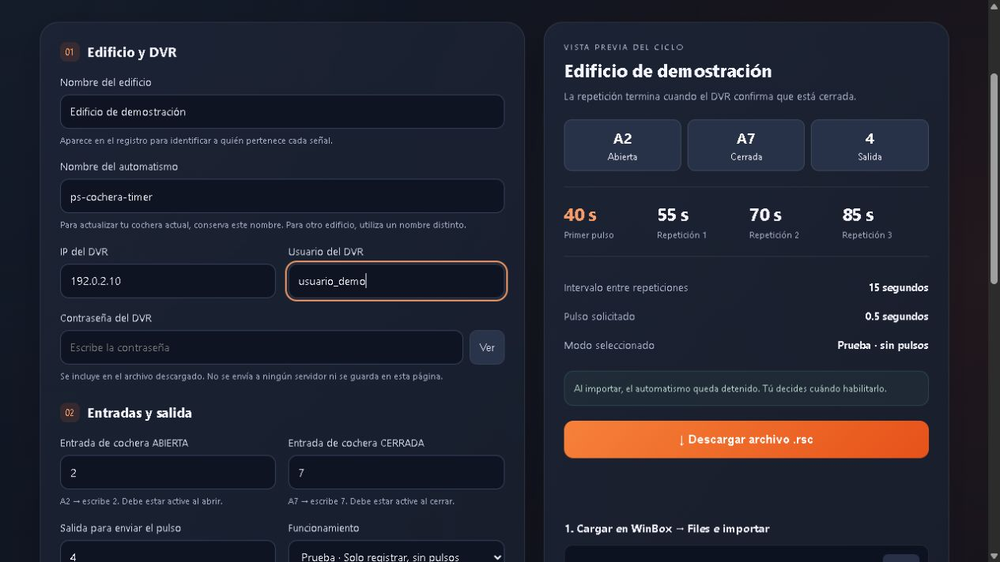
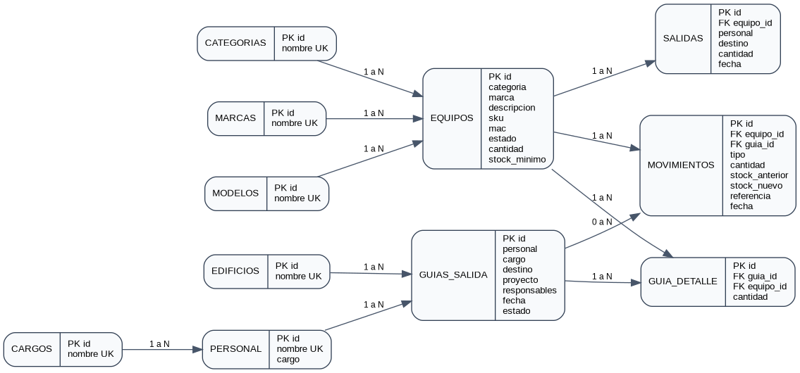
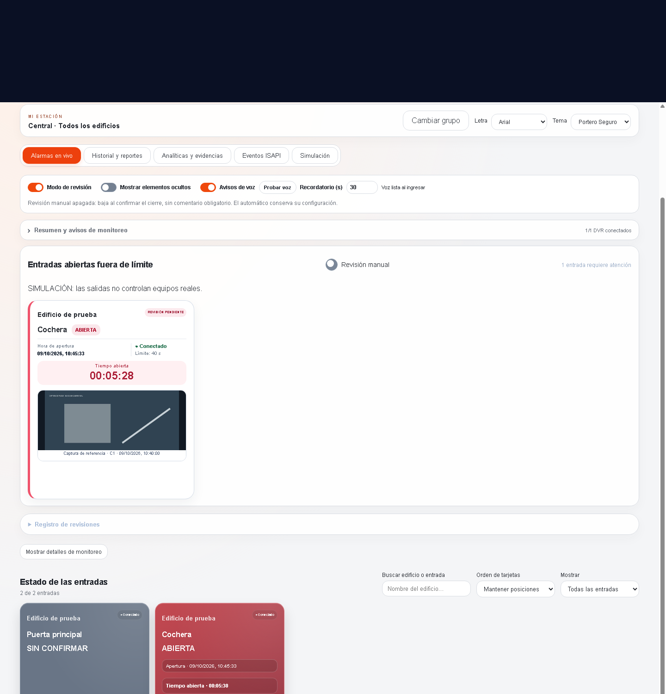
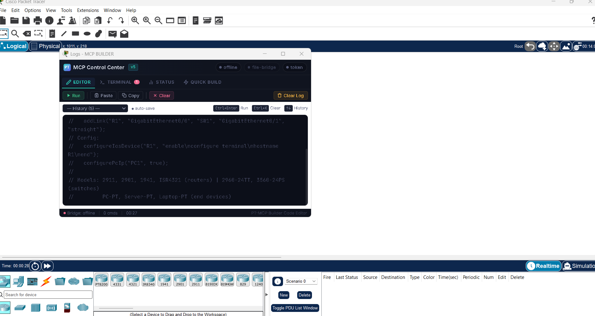

  

  <a href="https://github.com/Jescodem?tab=repositories">Explorar proyectos</a>
  &nbsp; · &nbsp;
  <a href="https://github.com/Jescodem/juego-preguntas-api">API educativa</a>
  &nbsp; · &nbsp;
  <a href="https://github.com/Jescodem/employer_system_spring_mvc_thymeleaf">Sistema de contactos</a>

## Hola, soy Jescodem 👋

Desarrollo herramientas para automatizar tareas y conectar aplicaciones con equipos de red. Mis proyectos combinan desarrollo web, integración de dispositivos y soluciones para la operación diaria.

- **Automatización:** scripts, configuración de equipos y procesos repetitivos.
- **Redes e integración:** intercomunicadores, videovigilancia y MikroTik.
- **Aplicaciones web:** inventarios, reportes, paneles y servicios API.

## Tecnologías que uso

| Desarrollo | Datos y automatización | Redes y dispositivos |
| :--- | :--- | :--- |
| Python · Flask · Django | SQLite · MySQL · Selenium | MikroTik · RouterOS |
| Java · Spring Boot · Thymeleaf | PowerShell · Git · GitHub | ISAPI · APIs HTTP |
| HTML · CSS · JavaScript | Reportes e integración de datos | Hikvision · Akuvox |

## Proyectos públicos

### 🎮 [API para un juego educativo](https://github.com/Jescodem/juego-preguntas-api)

Backend de un juego educativo desarrollado con **Python, Django REST Framework y MySQL**.

### 📇 [Sistema de contactos](https://github.com/Jescodem/employer_system_spring_mvc_thymeleaf)

Aplicación web para agregar, consultar, editar y eliminar contactos con **Java, Spring Boot, Thymeleaf y MySQL**.

### 🌐 [Proyecto web](https://github.com/Jescodem/simple_web)

Proyecto web con módulos de blog y portafolio, estructura Django y plantillas HTML.

## Más proyectos

Además de los proyectos públicos, desarrollo estas herramientas en repositorios privados:

| Proyecto | Qué hace | Tecnologías |
| :--- | :--- | :--- |
| Inventario de activos | Equipos, movimientos, guías y seguimiento de activos | Python · Flask · SQLite |
| Generador MikroTik | Configuración RouterOS y temporización de señales de cochera | HTML · JavaScript · RouterOS |
| HVR Details | Inventario y diagnóstico de una flota de grabadores | Python · ISAPI |
| Autoaprovisionamiento Akuvox | Configuración centralizada de intercomunicadores E12 | Python · HTTP · MikroTik |
| Marcaciones y asistencia | Horarios, tardanzas, horas extras y reportes | Python · ISAPI · Excel |
| PhotoSwiper | Revisión de fotografías y vídeos en una aplicación móvil | React Native · Expo |
| Widget de uso de Claude | Consulta de uso y coste estimado a partir de registros locales | Python · Windows |
| Panel de proyectos | Iniciar y detener aplicaciones, elegir puerto y consultar logs | Python · Web |

## Galería de proyectos y referencias

### Generador MikroTik · interfaz de demostración

Captura de la interfaz HTML existente en el repositorio del generador. Se abrió localmente con un edificio ficticio, una dirección de ejemplo y el modo **Prueba · sin pulsos**. No se enviaron órdenes a equipos.

### Inventario de activos · modelo de datos

Diagrama recuperado de la documentación **fase 1** del sistema de inventario. Muestra relaciones entre equipos, edificios, personal, guías y movimientos; contiene nombres de tablas y campos, sin registros de clientes.

### Dashboard de entradas y alarmas

Vista del proyecto en **modo simulación**, con un edificio de prueba: estado de puerta/cochera, tiempo de apertura y seguimiento de alertas.

Ver captura del dashboard

### Laboratorio de redes · Packet Tracer

Referencia del entorno empleado para un ejercicio EIGRP en Cisco Packet Tracer. La captura documenta las herramientas del laboratorio.

Ver entorno de laboratorio

## En lo que trabajo

Integración de dispositivos, configuración centralizada, monitoreo de eventos y herramientas de gestión. Los proyectos operativos se mantienen en repositorios privados.

---

<strong>Código que conecta aplicaciones, equipos y tareas cotidianas.</strong>

